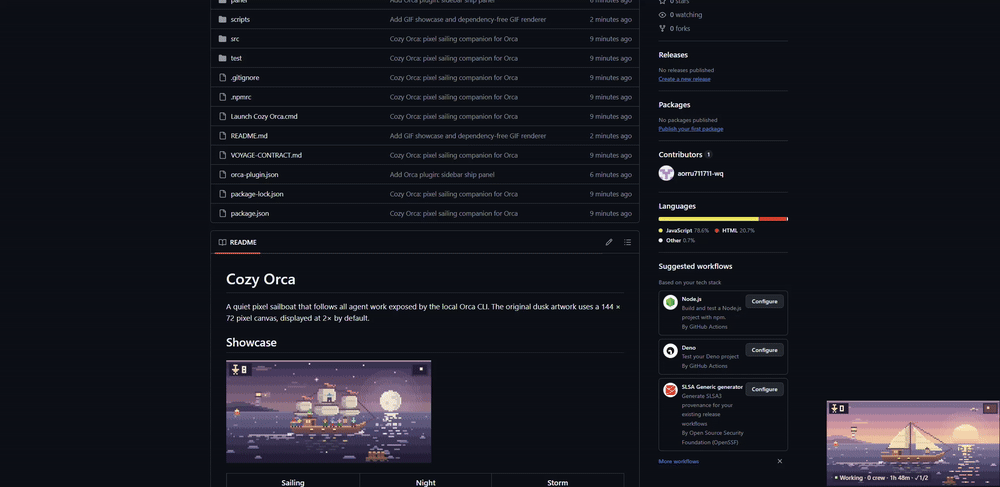
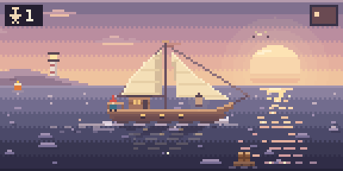
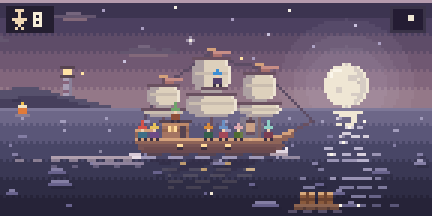
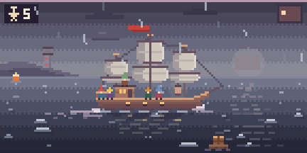
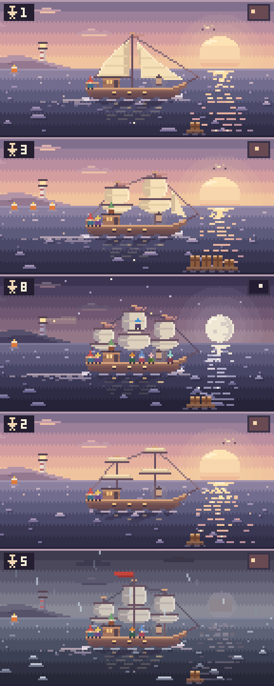
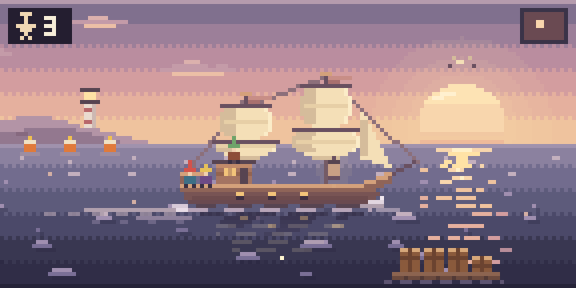
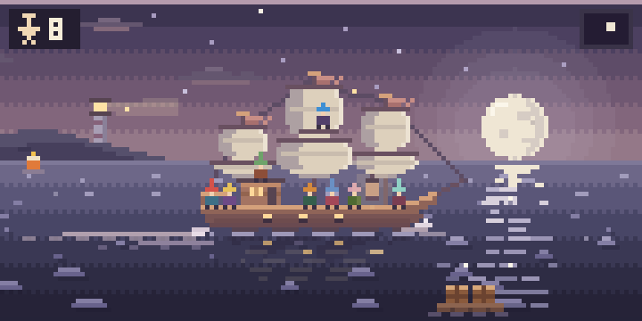
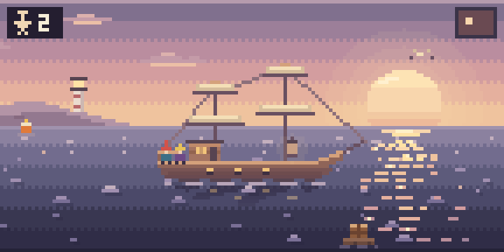
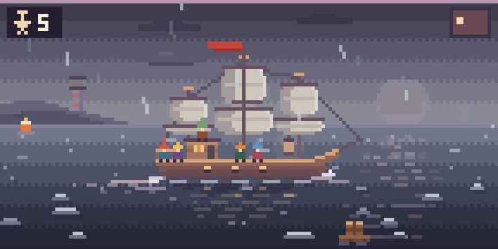

<div align="center">

# ⛵ Cozy Orca

**A quiet pixel sailboat that follows your AI agents' work.**


<br>


[Download](#download) · [Supported](#supported) · [Showcase](#showcase) · [Claude Desktop](docs/claude-desktop.md) · [Claude Code, Codex, Antigravity](docs/codex-and-claude-code.md) · [Pi](docs/pi.md)

</div>

---

One ship, many moods: sails up while agents work, a bigger ship with more crew, lanterns at night, furled sails when resting, and rain when something fails.

A quiet pixel sailboat that follows AI agent work on your machine. It reads the local Orca fleet when Orca is running, and it also follows Claude Desktop, Claude Code, Codex Desktop, the Codex CLI, Antigravity/`agy`, and Pi through hooks, MCP, or a small extension. The original dusk artwork uses a 144 × 72 pixel canvas, displayed at 2× by default.

## Supported

### Platforms

| Platform | App |
| --- | --- |
| Windows | portable zip |
| macOS (Apple silicon and Intel) | portable zip |
| Linux (x64 and arm64) | portable zip |
| Orca sidebar | plugin that draws the scene |

### Agents

| Agent | How the ship follows it |
| --- | --- |
| Orca fleet (any agent Orca tracks) | local Orca CLI |
| Claude Desktop | MCP (`ship_set_status`) — [setup](docs/claude-desktop.md) |
| Claude Code | hooks — [setup](docs/codex-and-claude-code.md) |
| Codex Desktop | hooks (same file as the CLI) — [setup](docs/codex-and-claude-code.md) |
| Codex CLI | hooks — [setup](docs/codex-and-claude-code.md) |
| Antigravity / `agy` | hooks and MCP — [setup](docs/codex-and-claude-code.md) |
| Pi | extension — [setup](docs/pi.md) |

Several sources can sail at once. Each live session is a crew member. Orca is optional when you only use the hook, MCP, or Pi paths.

## Showcase

### Floating on your desktop

The ship stays on top of whatever you are doing, here floating in the corner while browsing GitHub.




### Pixel art


| Sailing | Night | Storm |
| --- | --- | --- |
|  |  |  |

Regenerate the GIFs with `node scripts/render-gif.cjs docs/showcase/tour.gif day1,day3,night8,idle2,storm5 3 4`. No extra dependencies are needed.

Stills:



| Scene | What you see |
| --- | --- |
|  | **Sailing at sunset.** One crew means a single-mast sloop. Waves slide past the steady hull, the sun lays a glittering path, and the pennant flutters. |
|  | **More crew, bigger ship.** Two to four crew raise two square-rigged masts. Buoys show remaining work and crates on a raft show finished work. |
|  | **Night.** Eight crew sail a three-master under a round moon, twinkling stars and a sweeping lighthouse beam. |
|  | **Resting.** Sails are furled, the lantern is quiet, and the water only breathes. |
|  | **Storm.** An explicit failure brings rain, grey light and a red flag. |

Regenerate the images with `node scripts/render-showcase.cjs docs/showcase/all.png day1,day3,night8,idle2,storm5 3`.

## Download

This git repository does not contain the portable app. The executable is larger than GitHub allows in a repository, so a clone or a source zip will not include it.

| System | Download |
| --- | --- |
| Windows | [Cozy Orca 1.3.0 for Windows](https://github.com/aorru711711-wq/cozy-orca/releases/download/v1.3.0/Cozy-Orca-1.3.0-win32-x64.zip) |
| macOS, Apple silicon | [Cozy Orca 1.3.0 for Apple silicon](https://github.com/aorru711711-wq/cozy-orca/releases/download/v1.3.0/Cozy-Orca-1.3.0-darwin-arm64.zip) |
| macOS, Intel | [Cozy Orca 1.3.0 for Intel Macs](https://github.com/aorru711711-wq/cozy-orca/releases/download/v1.3.0/Cozy-Orca-1.3.0-darwin-x64.zip) |
| Linux, 64-bit | [Cozy Orca 1.3.0 for Linux x64](https://github.com/aorru711711-wq/cozy-orca/releases/download/v1.3.0/Cozy-Orca-1.3.0-linux-x64.zip) |
| Linux, ARM | [Cozy Orca 1.3.0 for Linux arm64](https://github.com/aorru711711-wq/cozy-orca/releases/download/v1.3.0/Cozy-Orca-1.3.0-linux-arm64.zip) |

Unzip the archive anywhere. No installation or administrator access is needed.

- **Windows.** Double-click **Launch Cozy Orca.cmd**.
- **macOS.** Double-click **Launch Cozy Orca.command**. The first time, if macOS blocks it, right-click that file, choose **Open**, then **Open**. The script clears the download quarantine on `Cozy Orca.app` and opens it. The app does not show a Dock icon.
- **Linux.** Run `./launch-cozy-orca.sh` from the unzipped folder. A normal desktop already has the GTK libraries Electron needs. The script starts the app without the setuid sandbox helper, which a portable unzip cannot install.

For the Orca fleet path, Orca must already be running. The companion looks for `orca.exe` on Windows and `orca` on macOS and Linux, on your PATH, and it reconnects automatically. To use a specific Orca executable, set `COZY_ORCA_CLI` to that native path before launching. `.cmd` wrappers are not accepted. Claude Desktop, Claude Code, Codex, Antigravity/`agy`, and Pi can move the ship without Orca after their setup steps.

Settings and temporary files are created in `data` beside the app. On macOS that folder is next to `Cozy Orca.app`, not inside the bundle. Keep `data` with the app when you move it.

- Drag the scene to move it. It starts in the bottom-right corner, above the taskbar or Dock.
- Hover to reveal the **···** settings button. Right-click also opens settings.
- Choose **2×**, **3×**, or **4×**, toggle **Reduced motion**, or reset its position.
- Click the sailboat icon in the menu bar or system tray to hide or show it. Right-click that icon for settings or **Quit Cozy Orca**. Windows may put the icon in the tray overflow.
- Size, position, and reduced motion survive restart. Starting a second copy shows the first.

The companion stays above ordinary apps and browser fullscreen video without activating itself when shown. Exclusive fullscreen applications, secure Windows screens, and other topmost overlays can take precedence. It reports work; it never pauses or resumes an agent. There is no sound, notification, automatic startup, telemetry, or cloud service.

## Status

| Label | Meaning |
| --- | --- |
| Working | At least one agent/workspace reports work. The sail is raised and water moves. |
| Working · needs input | Work continues while another agent is waiting or blocked. The lantern lights. |
| Needs input | No work is active; Orca reports waiting or blocked work. |
| Paused | The most recently ended agent explicitly reports interruption/cancellation. |
| Idle | No active work is reported in a complete snapshot. |
| Finished | Previously observed agents ended; a three-second glow plays once. This does not mean success. |
| Disconnected | Orca cannot be reached or its CLI is missing. Retrying automatically. |
| Status unavailable | Timeout, stale or unknown status, malformed data, truncated listing, or omitted hosts. |

The fleet CLI is read every two seconds after the previous request finishes, with a five-second timeout and no overlapping requests. Task inventory uses the same rule and waits its turn, as described below. Monitoring covers hosts returned by the current local Orca connection; omitted hosts make the status unavailable. Disconnection or disappearing rows never trigger a completion glow. Startup does not replay past completions.

The bottom line is one pill. The status dot stays separate. A known total looks like `Working · 3 crew · 1h 24m · ✓7/10`. When the total is unknown, it looks like `Working · 1 crew · 12m · ✓7`, and the tooltip says these are observed turns. The pill never shows `/0` or a guessed total. Sailing time is whole minutes of active sailing. Needs input and failures stay visible as the waiting flare and the error storm; the status word stays short.

## Development

Node.js is required only for development. From this folder in PowerShell:

```powershell
$env:TEMP = "$PWD/.tmp"
$env:TMP = $env:TEMP
$env:electron_config_cache = "$PWD/.cache/electron"
New-Item -ItemType Directory -Force .tmp | Out-Null
npm ci
npm test
npm run verify
npm start
npm run package
```

`npm run verify` runs Electron smoke checks, captures the voyage fixtures and a contact sheet into `artifacts`, and checks the installed Orca CLI, including its task inventory. It uses separate verification settings. `npm run package` writes one folder per system under `dist/v1.3.0/` and a zip for each in `dist/`. Those folders follow the package version, so an earlier portable app and the user data beside it stay in place. Set `COZY_PACKAGE_TARGETS` to a comma-separated list such as `linux-x64,darwin-arm64` to build only those. A Windows checkout cannot build the macOS app unless it is allowed to create symlinks; the macOS zip is built on a Mac.

All app-managed data stays with the app. Development dependencies and caches live in this project. The portable folder can sit on any drive; its `data` and `.tmp` folders live beside the executable. The launch script sets temporary storage before Electron starts.

The default CLI is `orca.exe` on Windows and `orca` on macOS and Linux, found on your PATH. To override it, set `COZY_ORCA_CLI` to a native Orca executable path before launching; `.cmd` wrappers are deliberately not executed through a shell. `COZY_DATA_DIR` can select another data folder.

Artwork and palette: `src/scene.js`. Status aggregation: `src/status.cjs`. Task inventory: `src/tasks.cjs`. Window, tray, and settings: `src/main.cjs`. The renderer receives only display status, never prompts, task specs, or raw outcomes.

## Task progress

The boat reads orchestration tasks with the same native Orca executable it uses for fleet status. Commands are `orchestration run-list` and, for each real non-legacy run, `orchestration task-list`. It never uses a shell. Windows stay hidden. Each command times out after five seconds, stdout is capped at 16 MB, and only one command runs at a time. Fleet status still refreshes about every two seconds. The task inventory refreshes about every ten seconds, after the fleet command in front of it finishes.

Legacy runs (`legacy: 1`, or a legacy read-only task list) are ignored. A run is tracked only when it still has pending or in-progress work. Fully completed historic runs are left out, so old voyages do not inflate the count. Once this session tracks a run, that run stays in the inventory until the companion quits, including after its last task finishes. The next launch starts the selection again. A run that disappears from a complete run list is dropped. A failed refresh does not forget the runs already selected, but it does not keep publishing their old rows.

Published progress is `{ known, items, runIds }`. Each item is only `{ id, runId, state, title }`. `state` is `pending`, `working`, `completed`, `failed`, or `cancelled`. Titles come from the task title, with the display name as a fallback, never from the spec, result, or prompt. Titles lose control characters and stop at 160 characters. Duplicate ids collapse when the copies agree and reject the whole inventory when they do not. A partial page, a count that does not match the rows, an unknown status, a repeated cursor, or a timed-out command makes the whole inventory unknown. Unknown progress is `{ known: false, items: [], runIds: [] }`. That is not a total of zero, and it does not mean the work finished.

Orca's own statuses map this way: `pending`, `ready`, and `blocked` become `pending`; `dispatched` becomes `working`; `completed` stays `completed`; `failed` stays `failed`. `failed` whose result text is exactly `cancelled` becomes `cancelled`. Orca has no separate cancelled status.

If the task commands fail, the fleet snapshot still stands. Its kind, label, and agents stay as the fleet read reported them. Task progress on that snapshot is unknown until a later refresh succeeds.

Limits:

- The companion is read-only. It cannot start, stop, cancel, or edit a task.
- The inventory is every non-legacy orchestration run with unfinished work on the connected Orca runtime. It is not limited to this workspace, and it does not include tasks that live outside orchestration runs.
- Historic runs whose tasks are already all completed, failed, or cancelled at startup are not tracked. Their old failures are not part of the crate count. A failure that happens after this session started tracking the run stays visible.
- `ready` and `blocked` both display as pending. Cancellation is recognized only from the exact failed result `cancelled`.
- Task-list has no page cursor. A listing is accepted only when `count` equals the returned rows. A listing over 16 MB is rejected instead of cut down into a false total.
- Run-list is followed for at most 20 pages. A cursor that does not end, or that repeats, is unknown.
- An empty known inventory means zero tasks in scope. The pill should omit the fraction when the total is zero or unknown. Unknown inventory must not be drawn as `✓0/0`.
- A task refresh holds the next fleet read until it finishes, so a slow inventory delays one fleet sample. Commands never overlap.
- Specs, prompts, results, and raw outcomes are not part of display data.
